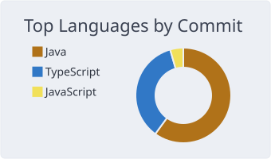
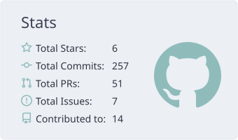

<h1 align="center">Huang Yongliang</h1>

  <strong>CrazyTiger</strong> · Shenzhen · <a href="mailto:huangyongliang6@gmail.com">huangyongliang6@gmail.com</a>

Java · TypeScript · JavaScript · Python

  <picture>
    <source media="(prefers-color-scheme: dark)" srcset="https://readme-typing-svg.demolab.com?font=Outfit&weight=600&size=26&duration=2800&pause=900&color=7AA2F7&center=true&vCenter=true&background=00000000&width=680&height=48&lines=Spring+Boot+%C2%B7+React+%C2%B7+Vue+%C2%B7+Docker;GitHub+Pages+%C2%B7+plain+HTML+%C2%B7+Compose;tech-notes+%C2%B7+Super+Mario+%C2%B7+kiln">
    <source media="(prefers-color-scheme: light)" srcset="https://readme-typing-svg.demolab.com?font=Outfit&weight=600&size=26&duration=2800&pause=900&color=3454D1&center=true&vCenter=true&background=00000000&width=680&height=48&lines=Spring+Boot+%C2%B7+React+%C2%B7+Vue+%C2%B7+Docker;GitHub+Pages+%C2%B7+plain+HTML+%C2%B7+Compose;tech-notes+%C2%B7+Super+Mario+%C2%B7+kiln">
    
  </picture>

  黄永亮 · 深圳。GitHub Pages 笔记、无构建 HTML 游戏、Spring Boot / Python 仓库。

  
  &nbsp;
  

## Repositories

**[tech-notes](https://github.com/huangyongliang/tech-notes)** · [GitHub Pages](https://huangyongliang.github.io/tech-notes/)

Topic indexes and short notes. Browse on GitHub or the Pages site.

按主题索引的技术笔记，GitHub Pages 可直接看。

**[Super Mario](https://github.com/huangyongliang/Super-Mario)** · [Pages](https://huangyongliang.github.io/Super-Mario/)

HTML, CSS, and JavaScript platformer. No build: open `index.html` or the Pages URL. Tests run on Node 18+. Non-commercial fan project; pixel art and audio in the repo are original.

纯 HTML / CSS / JavaScript，无构建。Node 18+ 测试。非商业同人，像素和音频是仓库原创。

**[kiln](https://github.com/huangyongliang/kiln)**

Python. First runnable slice of an artifact-build platform: API outline, Simplified Chinese console, and Compose for Postgres, Jenkins, and Gitea. Tests run in CI. Not a finished product.

Python。制品构建平台一期骨架：API、中文控制台、Postgres / Jenkins / Gitea Compose。不是完整产品。

**[memora-spring](https://github.com/huangyongliang/memora-spring)**

Local multi-agent memory console. Spring Boot 3 on JDK 17, React + Vite UI. Scans local agent directories and reads their Markdown memory.

本地多 Agent 记忆管理台。Spring Boot 3、JDK 17、React + Vite。

**[ruoyi-tiger](https://github.com/huangyongliang/ruoyi-tiger)**

Enterprise admin on RuoYi / Flowable, developed from RuoYi-Nbcio. Adds DingTalk attendance sync, Excel import, and reports. Java 8, Spring Boot 2.7, Vue 2, Docker Compose.

基于 RuoYi / Flowable，二次开发自 RuoYi-Nbcio。钉钉考勤同步、Excel 导入、报表。Java 8、Spring Boot 2.7、Vue 2。

**[dasuan](https://github.com/huangyongliang/dasuan)**

WeChat mini program on cloud development. Markdown editor, image upload, public sharing, and anonymous posts.

微信小程序云开发。Markdown 编辑、图片上传、公开分享、匿名树洞。

### Java study repos

- [learner-JVM](https://github.com/huangyongliang/learner-JVM) — JVM notes in Java
- [learner-algorithm](https://github.com/huangyongliang/learner-algorithm) — sorting and shortest paths (Floyd, Dijkstra, Bellman-Ford)
- [learner-concurrency](https://github.com/huangyongliang/learner-concurrency) — Java concurrency

JVM、排序与最短路径、Java 并发。

## Languages and tools

Used in the repositories above.

  <picture>
    <source media="(prefers-color-scheme: dark)" srcset="https://skillicons.dev/icons?i=java,spring,ts,js,py,react,vue,html,css,docker&perline=10&theme=dark">
    <source media="(prefers-color-scheme: light)" srcset="https://skillicons.dev/icons?i=java,spring,ts,js,py,react,vue,html,css,docker&perline=10">
    
  </picture>

上面这些仓库里用到的语言和工具。

## Activity

Commit languages, totals, streak, and the past year.

提交语言、累计数字、连续提交，以及近一年贡献。

<picture>
  <source media="(prefers-color-scheme: dark)" srcset="./profile-summary-card-output/tokyonight/2-most-commit-language.svg">
  <source media="(prefers-color-scheme: light)" srcset="./profile-summary-card-output/nord_bright/2-most-commit-language.svg">
  
</picture>
&nbsp;
<picture>
  <source media="(prefers-color-scheme: dark)" srcset="./profile-summary-card-output/tokyonight/3-stats.svg">
  <source media="(prefers-color-scheme: light)" srcset="./profile-summary-card-output/nord_bright/3-stats.svg">
  
</picture>

 

<picture>
  <source media="(prefers-color-scheme: dark)" srcset="https://streak-stats.demolab.com?user=huangyongliang&hide_border=true&background=1A1B27&ring=7AA2F7&fire=BB9AF7&currStreakNum=C0CAF5&sideNums=C0CAF5&currStreakLabel=7AA2F7&sideLabels=A9B1D6&dates=565F89&stroke=1A1B27&border=1A1B27">
  <source media="(prefers-color-scheme: light)" srcset="https://streak-stats.demolab.com?user=huangyongliang&hide_border=true&background=FFFFFF&ring=3454D1&fire=C43E5C&currStreakNum=3454D1&sideNums=24292F&currStreakLabel=3454D1&sideLabels=57606A&dates=6E7781&stroke=FFFFFF&border=FFFFFF">
  
</picture>

 

<picture>
  <source media="(prefers-color-scheme: dark)" srcset="https://github-readme-activity-graph-sigma.vercel.app/graph?username=huangyongliang&bg_color=1a1b27&color=7AA2F7&line=7AA2F7&point=BB9AF7&area=true&hide_border=true&radius=16&custom_title=Contributions">
  <source media="(prefers-color-scheme: light)" srcset="https://github-readme-activity-graph-sigma.vercel.app/graph?username=huangyongliang&bg_color=ffffff&color=3454D1&line=3454D1&point=C43E5C&area=true&hide_border=true&radius=16&custom_title=Contributions">
  
</picture>

