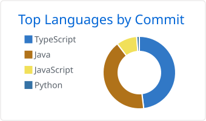
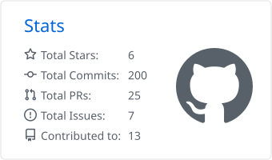

# 黄永亮 · CrazyTiger

深圳 · [huangyongliang6@gmail.com](mailto:huangyongliang6@gmail.com)

公开仓库里的几件东西：能在线看的笔记、能在浏览器里玩的游戏，以及几个自己的项目。

Notes, a browser game, and a few of the public projects.

---

## 项目

**[tech-notes](https://github.com/huangyongliang/tech-notes)** 
个人技术学习笔记，按主题整理链接、短笔记和学习记录。 
[在线阅读 / Read](https://huangyongliang.github.io/tech-notes/)

**[Super Mario](https://github.com/huangyongliang/Super-Mario)** 
用 HTML、CSS 和 JavaScript 写的平台游戏，不用构建，打开就能玩。非商业同人作品。 
[试玩 / Play](https://huangyongliang.github.io/Super-Mario/)

**[kiln](https://github.com/huangyongliang/kiln)** 
制品构建平台的一期骨架：API、简体中文控制台，以及 Postgres、Jenkins、Gitea 的 compose。还不是完整产品。 
First runnable slice of an artifact-build platform. Not a finished product.

**[memora-spring](https://github.com/huangyongliang/memora-spring)** 
本地多 Agent 记忆管理台，Spring Boot 3、JDK 17、React。 
Local multi-agent memory management console.

**[ruoyi-tiger](https://github.com/huangyongliang/ruoyi-tiger)** 
基于 RuoYi / Flowable 的企业管理平台，增加钉钉考勤同步和报表。二次开发自 RuoYi-Nbcio。 
Enterprise platform on RuoYi / Flowable, with DingTalk attendance sync and reports.

**[dasuan](https://github.com/huangyongliang/dasuan)** 
基于微信小程序云开发的极简笔记：Markdown 编辑、图片上传、公开分享、匿名树洞。 
Minimal WeChat mini-program notebook: Markdown, images, public sharing, and an anonymous box.

### 学习记录

- [learner-JVM](https://github.com/huangyongliang/learner-JVM) — JVM
- [learner-algorithm](https://github.com/huangyongliang/learner-algorithm) — Java 算法，含排序和最短路径
- [learner-concurrency](https://github.com/huangyongliang/learner-concurrency) — Java 并发

---

## 概况

按提交统计的语言，以及累计的 Star、Commit、PR 和 Issue。

<picture>
<source media="(prefers-color-scheme: dark)" srcset="./profile-summary-card-output/github_dark/2-most-commit-language.svg">
<source media="(prefers-color-scheme: light)" srcset="./profile-summary-card-output/github/2-most-commit-language.svg">

</picture>
&nbsp;
<picture>
<source media="(prefers-color-scheme: dark)" srcset="./profile-summary-card-output/github_dark/3-stats.svg">
<source media="(prefers-color-scheme: light)" srcset="./profile-summary-card-output/github/3-stats.svg">

</picture>

